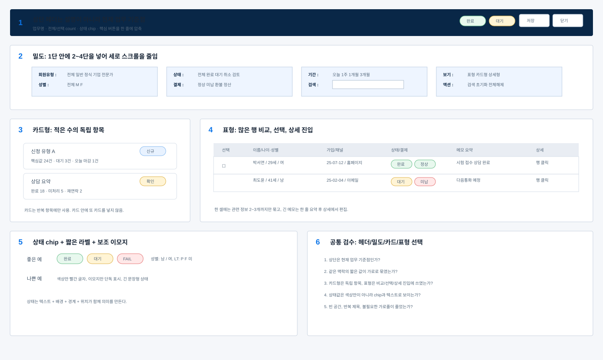

# 카드형 표형 선택기준

## 1. 대분류: 카드형과 표형의 차이

### 1.1 중분류: 카드형을 쓰는 경우

카드형은 서로 독립된 항목을 빠르게 훑거나, 한 항목 안에 제목/상태/요약/액션이 필요한 경우에 쓴다.

소분류:
- 서비스 목록
- 신청 유형
- 요약 통계
- 사용자용 안내 묶음
- 운영 대시보드의 작은 상태 패널

### 1.2 중분류: 표형을 쓰는 경우

표형은 여러 행을 비교하거나 정렬, 필터, 대량 선택이 필요한 경우에 쓴다.

소분류:
- 회원 목록
- 결제 목록
- 신청 접수 목록
- 상담 이력
- 납부 상세정보
- 정산 내역

## 2. 대분류: 카드형 기준

### 2.1 중분류: 카드 크기

소분류:
- 카드 radius는 8px 이하를 기본으로 한다.
- 관리자 화면에서는 큰 카드보다 작은 패널을 우선한다.
- 카드 안에 또 카드를 넣지 않는다.
- 카드 내부 padding은 내용량에 맞게 줄인다.

### 2.2 중분류: 카드 안 구성

소분류:
- 제목, 상태, 핵심값, 보조값, 액션 순서로 둔다.
- 짧은 값은 한 줄에 2-3개 묶는다.
- 가로줄은 꼭 필요한 구획에만 쓴다.
- 긴 설명을 반복 카드마다 넣지 않는다.

### 2.3 중분류: 카드형 금지 상황

소분류:
- 20개 이상 행을 비교해야 할 때
- 정렬과 일괄 선택이 필요할 때
- 각 항목의 열 구조가 거의 같을 때
- 같은 종류 데이터를 계속 스크롤해야 할 때

## 3. 대분류: 표형 기준

### 3.1 중분류: 표의 장점

소분류:
- 같은 위치에서 값을 비교할 수 있다.
- 체크박스 선택과 일괄 액션이 쉽다.
- 상태값과 날짜값을 빠르게 훑을 수 있다.
- 상세보기와 연결하기 좋다.

### 3.2 중분류: 표 안의 카드성 정보

표 안에서도 한 셀 안에 작은 묶음을 만들 수 있다.

예시:

```text
이름 셀: 김선수 / 34세 / 남
가입 셀: 25-03-15 / 이메일
상태 셀: 완료 / 정상
```

소분류:
- 주정보는 위 또는 왼쪽에 둔다.
- 보조정보는 작게 둔다.
- 한 셀에 2-3개까지만 묶는다.
- 긴 문장끼리는 한 셀에 합치지 않는다.

## 4. 대분류: 카드와 표를 함께 쓰는 경우

### 4.1 중분류: 상단 요약 + 하단 표

소분류:
- 상단은 2-4개 요약 패널
- 하단은 실제 데이터 표
- 요약 패널은 표의 필터 또는 상태 진입점 역할을 한다.

### 4.2 중분류: 표 + 우측 상세

소분류:
- 표는 목록과 비교
- 우측 상세는 선택 행 처리
- 상세가 열려도 표의 핵심 열은 보이게 한다.

### 4.3 중분류: 상세 안 표

소분류:
- 납부 상세, 회계 영역, 이력 로그는 표형이 적합하다.
- 입력 가능한 값은 input/select/date로 둔다.
- 표 안 날짜는 달력 선택을 지원한다.

## 공통 샘플: 밀도·헤더·카드형·표형 기준



샘플 번호 기준:
- 1번: 상단 헤더는 업무명, count, 상태 chip, 주요 버튼을 한 줄에 압축한다.
- 2번: 1단 안에 2~4단을 넣어 짧은 조건과 값을 가로로 묶는다.
- 3번: 카드형은 적은 수의 독립 항목이나 요약 패널에만 쓴다.
- 4번: 표형은 많은 행을 비교, 선택, 상세 진입해야 할 때 쓴다.
- 5번: 상태는 chip과 짧은 label로 표시하고, 이모지는 보조 신호로만 제한한다.
- 6번: 최종 검수는 헤더, 밀도, 카드/표 선택, 상태 표현, 빈 공간을 함께 확인한다.

## 5. 요약표

| 판단 | 카드형 | 표형 |
|---|---|---|
| 데이터 수 | 적음 | 많음 |
| 비교 | 약함 | 강함 |
| 일괄 선택 | 부적합 | 적합 |
| 설명 중심 | 적합 | 보통 |
| 운영 관리 | 보조 패널 | 기본 구조 |
| 상세 처리 | 카드 단독보다 Drawer 권장 | 행 선택 + 상세 권장 |
