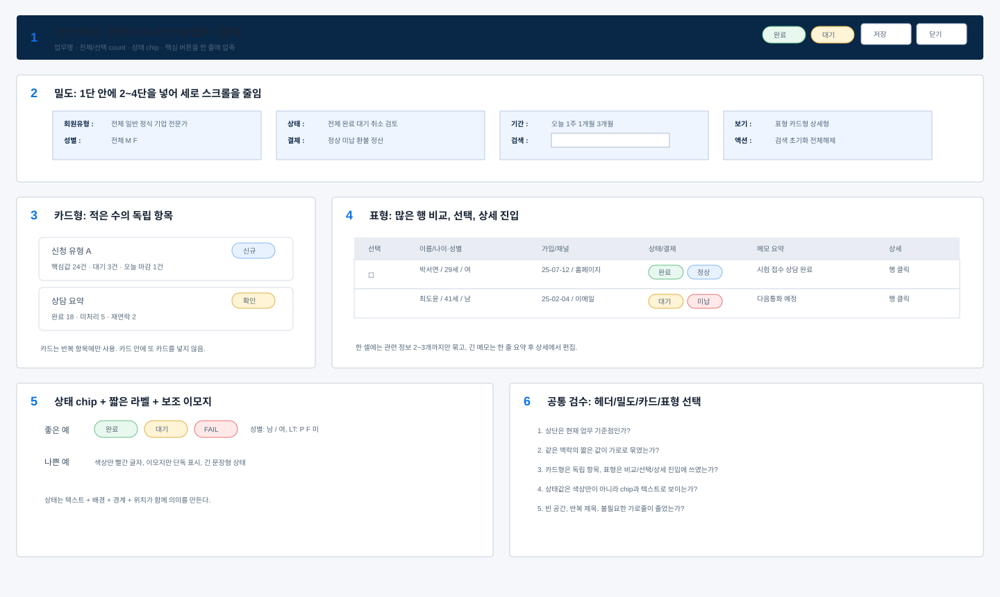

# 상태값 칩 라벨 이모지 기준

## 1. 대분류: 상태값의 역할

### 1.1 중분류: 상태는 판단을 빠르게 만드는 정보

상태값은 장식이 아니라 사용자가 다음 행동을 결정하게 하는 신호다.

소분류:
- 완료, 대기, 취소, 정상, 미납, 환불, 상담중 같은 값은 chip으로 표시한다.
- 색상만으로 상태를 표현하지 않는다.
- 상태 label은 짧고 일관되게 쓴다.

### 1.2 중분류: 상태 위치

소분류:
- 테이블에서는 해당 열 안에 작게 표시한다.
- 상세보기에서는 대상명 또는 주요 버튼 근처에 둔다.
- 업무 판단에 중요한 상태는 상단과 상세 내부에 중복 노출해도 된다.

## 2. 대분류: chip 기준

### 2.1 중분류: 기본 종류

| 상태 | 쓰는 경우 | 예시 |
|---|---|---|
| ok | 정상, 완료, 진행 가능 | 완료, 정상, 상담중 |
| wait | 대기, 보류, 확인 필요 | 대기, 미납, 정산대기 |
| fail | 실패, 위험, 취소 | FAIL, 취소, 환불 |
| info | 일반 안내, 참고 | 검토중, 신규 |

### 2.2 중분류: 크기

소분류:
- 테이블 안 chip은 작게 유지한다.
- 상세 헤더 chip은 테이블 chip보다 조금 커도 된다.
- chip 높이가 행 높이를 키우지 않게 한다.

### 2.3 중분류: 문구

소분류:
- `정상`, `완료`, `대기`처럼 짧게 쓴다.
- `결제가 정상적으로 완료되었습니다`처럼 문장형 상태는 쓰지 않는다.
- 실패/위험은 짧지만 눈에 띄게 한다.

## 3. 대분류: 이모지 사용

### 3.1 중분류: 쓸 수 있는 경우

이모지는 상태를 빠르게 구분하는 보조 장치로만 사용한다.

소분류:
- 성별, 알림, 경고, 완료 같은 짧은 반복값
- 테이블 셀 안에서 1개 이하
- 텍스트를 대체하지 않고 보조로만 사용

예시:

```text
김선수 / 34세 / 남
정상
완료
주의
```

### 3.2 중분류: 피해야 하는 경우

소분류:
- 이모지만 있고 텍스트가 없는 상태
- 한 셀에 여러 이모지가 몰리는 상태
- 업무 문서나 회계 영역에서 의미가 불명확한 이모지

## 4. 대분류: 짧은 라벨

### 4.1 중분류: 약어와 등급

소분류:
- `Lv.A`, `Lv.B`, `P`, `F`, `미`처럼 반복되는 짧은 값은 허용한다.
- 단, 처음 보는 사용자가 해석하기 어려우면 title 또는 상세에서 풀어준다.

### 4.2 중분류: 카운트

소분류:
- 탭과 요약에는 count를 붙인다.
- 예: `전체 50명`, `AI번역 13건`, `선택 10건`

## 공통 샘플: 밀도·헤더·카드형·표형 기준



샘플 번호 기준:
- 1번: 상단 헤더는 업무명, count, 상태 chip, 주요 버튼을 한 줄에 압축한다.
- 2번: 1단 안에 2~4단을 넣어 짧은 조건과 값을 가로로 묶는다.
- 3번: 카드형은 적은 수의 독립 항목이나 요약 패널에만 쓴다.
- 4번: 표형은 많은 행을 비교, 선택, 상세 진입해야 할 때 쓴다.
- 5번: 상태는 chip과 짧은 label로 표시하고, 이모지는 보조 신호로만 제한한다.
- 6번: 최종 검수는 헤더, 밀도, 카드/표 선택, 상태 표현, 빈 공간을 함께 확인한다.

## 5. 요약표

| 항목 | 기준 |
|---|---|
| 상태 | 짧은 chip으로 표시 |
| 색상 | 색상만 의존하지 않음 |
| 위치 | 테이블 셀, 상세 헤더, 업무 패널 |
| 이모지 | 보조 신호로만 제한 사용 |
| 약어 | 반복값은 허용, 필요 시 설명 제공 |
| 카운트 | 탭과 요약에 적극 사용 |
