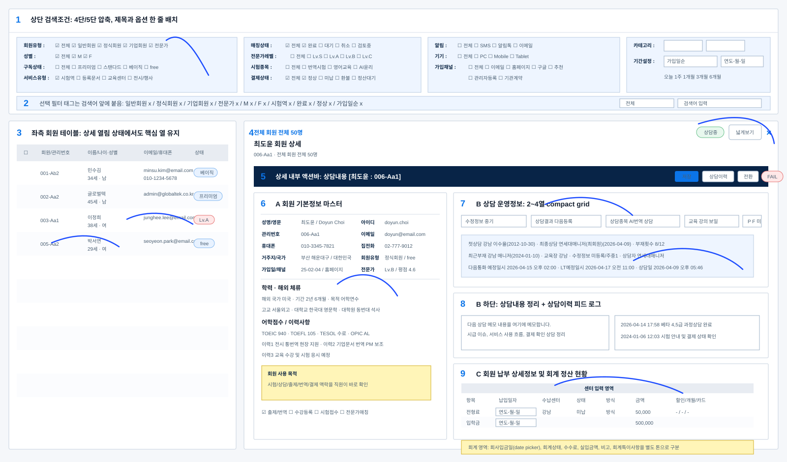

# 검색기능 테이블 상세보기 통합기준

기준 파일: `table_design/관리자패널_전체회원.html`, `table_design/table-design.css`, `table_design/table-design.js`

이 문서는 검색조건, 대량 테이블, 우측 상세보기 Drawer가 한 화면에 함께 있는 BO/DB 화면의 최신 조립 기준이다. 회원관리 화면에서 확정한 최신 방향을 우선 적용한다.



## 1. 대분류: 전체 구조

### 1.1 중분류: 화면은 세 덩어리로 본다

소분류:
- 상단 영역: 업무명, count, 탭, 상태, 주요 버튼
- 검색 영역: 조건, 선택 필터, 검색어, 검색/초기화
- 본문 영역: 테이블 목록 + 우측 상세보기

### 1.2 중분류: 기본 레이아웃

```text
상단 헤더
검색조건
검색어 + 선택 필터 태그
테이블 workspace
  왼쪽: 목록 테이블
  오른쪽: 상세 Drawer
```

상세가 닫히면 테이블은 전체 폭을 사용한다. 상세가 열리면 테이블은 핵심 열을 유지하고, 상세가 업무 처리에 충분한 폭을 가진다.

### 1.3 중분류: 실제 회원관리 샘플 이미지 읽는 법

위 샘플 이미지는 실제 `관리자패널_전체회원.html`에서 반복 적용할 검색 + 테이블 + 상세보기 기준을 번호로 표시한 것이다.

번호 기준:
- 1번: 상단 검색조건 전체. 회원유형, 성별, 구독상태, 서비스유형은 한 줄 흐름으로 붙이고, 매칭/시험/알림/기기/가입채널/카테고리는 4단 또는 5단으로 압축한다.
- 2번: 선택된 필터 태그와 검색어. 필터 태그는 검색어 앞에서 흐르고, 태그 해제 시 검색어 입력이 앞으로 밀린다.
- 3번: 좌측 회원 테이블. 상세가 열려도 checkbox, 회원/관리번호, 이름/나이·성별, 연락처, 상태 같은 핵심 열은 유지한다.
- 4번: 우측 상세 헤더. 대상명, 관리번호, 전체 count, 상태 chip, 넓게보기, 닫기를 같은 상단 맥락에 둔다.
- 5번: 상세 내부 액션바. 저장, 상담이력, 전환, FAIL은 업무 패널 안의 실행 액션으로 둔다.
- 6번: A 회원 기본정보 마스터. B가 오른쪽에 보여도 A의 핵심 인적정보, 학력, 해외, 어학, 이력, 사용 목적이 최대한 첫 화면에 들어오게 한다.
- 7번: B 상담 운영정보. 수강정보, 상담결과, 상담종목, 교육, 수정정보, LT 인터뷰 결과와 상담 운영값을 compact grid로 둔다.
- 8번: B 하단 메모/로그. 상담내용 정리와 상담이력 피드 로그는 B 아래에 붙여 현재 입력과 누적 이력을 분리한다.
- 9번: C 납부/회계 영역. 센터 입력 영역과 회계 영역을 표형으로 나누고, 납입일자와 회사입금일은 date picker를 쓴다.


## 2. 대분류: 검색조건

### 2.1 중분류: 조건 그룹 한 줄 원칙

필터 옵션은 세로로 쌓지 말고 제목과 내용을 같은 줄에 둔다.

필수 예시:

```text
회원유형 : 전체 일반회원 정식회원 기업회원 전문가
성별 : 전체 M F
구독상태 : 전체 프리미엄 스탠다드 베이직 free
서비스유형 : 시험역 구독센터 시험사이트 통번문서 전시/행사
```

소분류:
- checkbox는 유지한다.
- label과 checkbox가 한 줄 흐름 안에 있어야 한다.
- `회원유형`은 한 줄이 깨지지 않게 충분한 grid 폭을 준다.
- `서비스유형`은 `구독상태`에 붙여 같은 기본 조건 그룹에서 보이게 한다.

### 2.2 중분류: 검색조건 4-5단 구조

소분류:
- 1단: 회원유형, 성별, 구독상태, 서비스유형
- 2단: 매칭상태, 전문가레벨, 시험종목, 결제상태
- 3단: 알림, 기기, 가입채널
- 4단: 카테고리, 기간설정, 빠른 기간 버튼
- 필요하면 5단까지 확장하되 첫 화면 높이를 늘리지 않는다.

### 2.3 중분류: 가입채널 위치

가입채널은 별도 줄을 만들지 않는다.

소분류:
- 알림/기기 아래 또는 같은 운영 접근 조건 그룹에 둔다.
- `전체 이메일 홈페이지 구글 추천 관리자등록 기관계약`처럼 가로로 붙인다.
- 공간이 부족하면 2열 wrap을 허용한다.

### 2.4 중분류: 선택된 필터 태그

소분류:
- 선택된 필터는 검색조건 아래 별도 행으로 크게 만들지 않는다.
- 검색어 앞쪽에 유동 배치한다.
- 필터를 해제하면 검색어 input이 앞으로 당겨진다.
- 태그가 많으면 한 줄 wrap은 허용하되 테이블 시작점이 과하게 내려가지 않게 한다.

## 3. 대분류: 테이블

### 3.1 중분류: 행과 열

소분류:
- 한 행은 한 데이터 단위다.
- checkbox 열은 좁게 둔다.
- 이름, 나이, 성별처럼 함께 보는 정보는 한 셀에 묶는다.
- 가입일과 채널, 최근 로그인과 체류시간, 전문가 레벨과 평점은 한 셀 안에서 2줄 또는 한 줄로 묶는다.

### 3.2 중분류: 데이터 표현

예시:

```text
김선수 / 34세 / 남
25-03-15 / 이메일
26-02-08 / 42m
Lv.A / 4.8
완료 / 정상
```

소분류:
- 긴 메모는 한 줄 요약만 보여준다.
- 자세한 메모는 상세보기에서 확인한다.
- 상태값은 chip으로 표시한다.
- 이모지는 텍스트를 대체하지 않고 보조로만 사용한다.

### 3.3 중분류: 상세 닫힘/열림 폭

소분류:
- 상세 닫힘: 테이블이 전체 폭을 사용한다.
- 상세 열림: 테이블 핵심 열과 상세가 동시에 보인다.
- 넓게보기: 테이블을 접고 상세가 전체 작업폭을 사용한다.
- 가로 스크롤은 허용하되 핵심 열은 왼쪽에 둔다.

## 4. 대분류: 상세보기 헤더

### 4.1 중분류: 상세 헤더 구성

소분류:
- 왼쪽: 전체 회원 전체 50명, 회원명, 관리번호, 짧은 요약
- 오른쪽: `상담중`, `완료`, `정상` 같은 상태 chip, 넓게보기, 닫기
- 중복되는 진한 제목바는 만들지 않는다.

### 4.2 중분류: 내부 액션바

소분류:
- `저장`, `상담이력`, `전환`, `FAIL`은 내부 작업 패널 상단에 둔다.
- 액션바는 상세 헤더와 다른 역할이다.
- 상태 chip을 내부 액션바에만 몰아두지 않는다.

## 5. 대분류: A 회원 기본정보 마스터

### 5.1 중분류: A의 목적

A는 B와 C를 해석하기 위한 고정 정보다. 관리자가 상담하거나 정산할 때 "누구의 어떤 맥락인지" 계속 알 수 있어야 한다.

소분류:
- 성명/영문
- 아이디
- 관리번호
- 이메일
- 휴대폰, 집전화
- 거주지/국가
- 회원유형
- 가입일/채널
- 전문가 레벨/평점
- 내국인/외국인
- 학력/해외 체류
- 어학점수
- 이력사항
- 회원 사용 목적

### 5.2 중분류: A와 B 동시 노출

소분류:
- B가 보일 때 A의 모든 핵심 정보가 최대한 함께 보여야 한다.
- A를 너무 좁게 만들지 않는다.
- A 내부는 2열 label/value로 압축할 수 있다.
- 메모와 체크는 높이를 줄이되 읽을 수 있어야 한다.

## 6. 대분류: B 상담 운영정보

### 6.1 중분류: B의 목적

B는 현재 상담 운영과 다음 행동을 처리하는 영역이다.

소분류:
- 첫상담
- 최종상담
- 부재횟수
- 최근부재
- 교육장
- 수정정보
- 다음통화 예정일시
- LT예정일시
- 상담일
- 상담자
- 결과

### 6.2 중분류: 상담결과

소분류:
- 상담결과 선택은 기본 닫힘이다.
- 클릭하면 `미상담`, `완료`, `LT예약`, `다음등록`, `실종`, `부재`, `기타`가 보인다.
- 선택 후 한 줄로 접혀 빈 공간을 없앤다.

### 6.3 중분류: 인터뷰 결과

소분류:
- LT 인터뷰 결과는 상단 toolbar에서 `수정정보` 옆에 둔다.
- `P`, `F`, `미`처럼 짧은 선택값을 한 줄로 표시한다.
- 별도 큰 빈 영역을 만들지 않는다.

### 6.4 중분류: 상담내용과 이력

소분류:
- 상담내용 정리는 B 상담 운영정보 아래에 둔다.
- 상담이력 피드 로그도 B 아래에 붙인다.
- 현재 입력 메모와 누적 이력은 분리한다.

## 7. 대분류: C 납부 상세정보와 회계 영역

### 7.1 중분류: C의 목적

C는 센터 입력과 본부 회계 정리를 동시에 다루는 표형 작업 영역이다.

소분류:
- 전형료
- 입학금
- 수업료
- 교재비
- 납입일자
- 수납센터
- 상태
- 방식
- 금액
- 할인사유
- 개월
- 카드사
- 승인번호
- 회사입금일
- 회계상태
- 수수료
- 실입금액
- 비고
- 회계특이사항

### 7.2 중분류: 날짜 선택

소분류:
- 납입일자와 회사입금일은 달력 클릭으로 날짜를 선택하게 한다.
- 입력형 table 안에서도 date picker가 떠야 한다.
- 날짜는 직접 타이핑 가능하더라도 picker가 우선이다.

### 7.3 중분류: 센터 입력과 회계 구분

소분류:
- 센터 입력 영역과 회계 영역은 헤더 또는 배경 톤으로 나눈다.
- C는 카드보다 표형이 적합하다.
- 회계 영역은 노란색 계열처럼 다른 톤으로 구분할 수 있다.

## 8. 대분류: 상호작용

### 8.1 중분류: 검색

소분류:
- 검색 버튼은 검색어 input 근처에 둔다.
- 초기화는 검색 옆에 둔다.
- 필터 해제 시 태그와 조건 상태가 함께 갱신된다.

### 8.2 중분류: 테이블 행

소분류:
- 행 클릭으로 상세가 열린다.
- Enter와 Space로도 열 수 있어야 한다.
- 열린 행은 `is-open` 또는 같은 역할의 선택 표시를 가진다.

### 8.3 중분류: 상세

소분류:
- 닫기와 ESC가 작동한다.
- 넓게보기는 상세를 넓히고 테이블을 접는다.
- 닫을 때 선택 행 표시와 wide 상태를 정리한다.

## 9. 대분류: AI 작업지시 및 최종 검증

### 9.1 중분류: 10번 공통 운영 규칙 우선 적용

검색 + 테이블 + 상세보기는 여러 컴포넌트가 동시에 움직이므로 `10_AI작업지시_검수_기준.md`의 공통 가이드라인 V1과 최종 이행 검증 체크리스트를 반드시 적용한다.

소분류:
- 기존 파일의 패턴을 먼저 확인한다.
- 최신 사용자의 지시를 우선한다.
- 추가 지시, 변경, 모호함, 반복 수정이 있으면 브레이크 후 의도와 Workflow를 공유한다.
- 같은 검색/테이블/상세 구조가 4회 이상 반복되면 MD 자산화 여부를 확인한다.
- 작업 완료 후 미이행 체크 항목이 있으면 사유를 보고한다.

### 9.2 중분류: 검색/테이블/상세 전용 자율 검증

소분류:
- 검색조건을 바꾸면 검색어/필터태그/테이블 시작점까지 확인한다.
- 상세 폭을 바꾸면 A/B/C가 함께 보이는지 확인한다.
- 날짜 입력을 바꾸면 picker 동작을 확인한다.
- 테이블 셀 안 정보가 2-3개 단위로 정리되었는지 확인한다.
- 접근성 점검 페이지는 수정하지 않는다.

## 10. 대분류: 검수 체크리스트

### 10.1 중분류: 검색조건

소분류:
- `회원유형 : 전체 일반회원 정식회원 기업회원 전문가`가 한 줄인가?
- `서비스유형`이 `구독상태`와 같은 기본 조건 흐름에 있는가?
- `가입채널`이 별도 줄을 만들지 않는가?
- 선택 필터 태그가 검색어 앞에서 유동 배치되는가?

### 10.2 중분류: 테이블

소분류:
- 상세 닫힘 상태에서 테이블이 전체 폭인가?
- 상세 열림 상태에서 핵심 열이 보이는가?
- 셀 안에 관련 정보가 2-3개로 잘 묶였는가?
- 긴 메모가 표를 밀어내지 않는가?

### 10.3 중분류: 상세

소분류:
- 상태 chip이 넓게보기 근처에 있는가?
- A와 B가 동시에 보이는가?
- 상담결과는 기본 닫힘인가?
- LT 인터뷰 결과는 수정정보 옆인가?
- C 날짜 입력은 달력 선택이 가능한가?

## 11. 대분류: 실제 회원관리 화면 상세 반영 기준

### 11.1 중분류: 검색조건 실제 배치

검색조건은 큰 카드 여러 개가 아니라 한 개의 고밀도 조건 영역이다.

소분류:
- 첫 번째 조건 그룹은 `회원유형`, `성별`, `구독상태`, `서비스유형`을 포함한다.
- `회원유형 : 전체 일반회원 정식회원 기업회원 전문가`는 한 줄 유지가 우선이다.
- `성별 : 전체 M F`도 같은 그룹 안에서 짧게 둔다.
- `서비스유형`은 별도 큰 열로 분리하지 말고 `구독상태` 흐름에 붙인다.
- `가입채널`은 알림/기기 아래 빈 공간에 넣어 검색조건 전체 세로 높이를 줄인다.
- 카테고리, 기간설정, 빠른 기간 버튼은 오른쪽에 두되 검색조건 높이를 늘리지 않는다.

### 11.2 중분류: 선택 필터와 검색어 실제 동작

소분류:
- 선택된 필터 태그는 별도 줄을 만들지 않고 검색어 앞에 둔다.
- 태그가 삭제되면 해당 조건 상태도 함께 해제한다.
- 태그가 줄어들면 검색어 입력 영역이 앞으로 확장된다.
- 필터 전체 해제 버튼은 태그 묶음 끝 또는 검색 row 끝에 둔다.

### 11.3 중분류: 테이블 실제 셀 구성

소분류:
- `회원/관리번호`처럼 식별값은 좁은 폭에서 2줄로 표시한다.
- `이름/나이·성별`은 이름을 주값으로 두고 나이와 성별을 보조값으로 둔다.
- 이메일/휴대폰은 2줄까지 허용하되 row height를 과하게 키우지 않는다.
- 주소/국가는 보조값을 줄여 표시하고 긴 값은 상세에서 확인한다.
- 회원유형/구독상태는 chip 또는 짧은 라벨로 표시한다.
- 가입일/채널, 최근 로그인/체류시간은 한 셀 안에서 묶는다.
- 메모는 목록에서 한 줄 요약만 보이고, 전체 편집은 상세에서 처리한다.

### 11.4 중분류: 상세 헤더 실제 구조

소분류:
- 상세 전체 헤더에는 `전체 회원 전체 50명`, 회원명, 관리번호, 짧은 요약을 둔다.
- `상담중`, `완료`, `정상` 같은 현재 상태는 `넓게보기` 근처에 둔다.
- 내부에 같은 의미의 큰 진한 제목바를 다시 만들지 않는다.
- 내부 dark strip은 제목 중복이 아니라 `저장`, `상담이력`, `전환`, `FAIL` 같은 작업 액션 영역으로 둔다.

### 11.5 중분류: A 회원 기본정보 마스터 실제 구조

A는 B와 C를 해석하기 위한 고정 맥락이다. A가 좁아서 학력, 해외 체류, 어학점수, 이력사항이 숨으면 상세 업무 판단이 느려진다.

소분류:
- A는 최소 폭을 확보하고 내부를 2열 label/value로 압축한다.
- 성명/영문, 아이디, 관리번호, 이메일, 휴대폰, 집전화는 상단에 둔다.
- 거주지/국가, 회원유형, 가입일/채널, 전문가레벨/평점은 같은 그룹에 둔다.
- 학력/해외 체류, 어학점수, 이력사항은 A 안에서 접지 않고 기본 표시한다.
- 회원 사용 목적 textarea는 높이를 줄이되 읽을 수 있어야 한다.
- 출제/번역, 수강등록, 시험접수, 전문가매칭 체크는 한 줄 흐름으로 둔다.

### 11.6 중분류: B 상담 운영정보 실제 구조

소분류:
- B 상단 toolbar는 `수강정보`, `상담결과`, `상담종목`, `교육`, `수정정보`, `LT 인터뷰 결과` 순서로 한 줄에 압축한다.
- 상담결과는 기본 닫힘이며 클릭 시 `미상담`, `완료`, `LT예약`, `다음등록`, `실종`, `부재`, `기타`가 보인다.
- LT 인터뷰 결과는 `수정정보` 옆에 두고 `P`, `F`, `미`를 한 줄로 둔다.
- 상담 운영정보는 `첫상담`, `최종상담`, `부재횟수`, `최근부재`, `교육장`, `수정정보`, `상담자`, `다음통화 예정일시`, `LT예정일시`, `상담일`, `결과`를 compact grid로 둔다.
- 다음 예정일과 상담일처럼 날짜/시간이 필요한 값은 datetime 입력을 쓴다.

### 11.7 중분류: 상담내용 정리와 피드 로그 실제 구조

소분류:
- 상담내용 정리는 현재 입력 메모다.
- 상담이력 피드 로그는 누적 이력이다.
- 두 영역은 B 상담 운영정보 아래에 붙인다.
- 현재 입력 메모와 누적 이력을 하나의 textarea에 합치지 않는다.
- 피드 로그는 시간, 작성자 또는 이벤트, 요약 문장을 분리해 보여준다.

### 11.8 중분류: C 납부 상세정보와 회계 영역 실제 구조

C는 상세 안의 표형 작업 영역이다.

소분류:
- 센터 입력 영역과 회계 영역을 같은 C 안에서 나누어 표시한다.
- 센터 입력 영역에는 `항목`, `납입일자`, `수납센터`, `상태`, `방식`, `금액`, `할인사유`, `개월`, `카드사`, `승인번호`를 둔다.
- 회계 영역에는 `회사입금일`, `회계상태`, `수수료`, `실입금액`, `비고`, `회계특이사항`을 둔다.
- 행 항목은 `전형료`, `입학금`, `수업료`, `교재비`를 기본으로 한다.
- `납입일자`와 `회사입금일`은 클릭 시 달력으로 선택되어야 한다.
- 회계 영역은 센터 입력 영역과 다른 배경 톤을 써서 본부 정산 영역임을 구분한다.

### 11.9 중분류: 첫 화면 밀도 기준

소분류:
- 검색조건, 테이블 시작점, 상세 헤더, A/B 상단이 첫 화면에 함께 들어와야 한다.
- B가 열렸을 때 A의 핵심 정보가 함께 보여야 한다.
- C는 가로 스크롤이 생겨도 날짜/금액/상태/회계 특이사항이 같은 표 맥락 안에 있어야 한다.
- 빈 공간을 줄이되 직원이 하루 종일 보는 업무 화면이므로 상태와 입력 경계는 유지한다.

## 12. 요약표

| 번호 | 영역 | 핵심 기준 |
|---|---|---|
| 1 | 상단 | 업무명, count, 상태, 주요 버튼 |
| 2 | 검색조건 | 제목과 옵션 한 줄, 4-5단 압축 |
| 3 | 선택 필터 | 검색어 앞 유동 태그 |
| 4 | 테이블 | 상세 닫힘 시 전체 폭, 셀 2-3개 정보 묶음 |
| 5 | 상세 헤더 | 대상명, 상태 chip, 넓게보기, 닫기 |
| 6 | A | 회원 기본정보 마스터, B와 함께 보이게 |
| 7 | B | 상담 운영정보, 상담결과 기본 닫힘 |
| 8 | B 하단 | 상담내용 정리, 상담이력 피드 로그 |
| 9 | C | 납부/회계 표형, 날짜 picker |
| 10 | 상호작용 | 검색, 행 클릭, ESC, 넓게보기 |
| 11 | AI 검수 | 10번 공통 체크리스트 적용, 최신 지시 우선, 미이행 사유 보고 |
